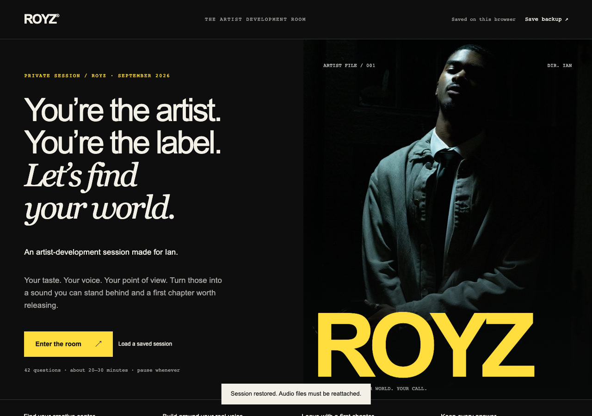

# ROYZ Artist Lab

An offline, single-file artist-development app: a 42-question guided session that turns a new musician's real answers into a provisional artist and label brief, an 11-slide pitch, and a local listening test for comparing vocal takes.



## Why

It was built for a filmmaker (Ian, performing as Royz) starting to make music with Suno's help and his own voice. Early on, the hard questions are about identity and voice, not marketing: whether the lead vocal has to be his own recording, how much time he really has, what the budget is. The app asks those questions one at a time, keeps every written answer word for word, and produces recommendations that it labels as provisional. Nothing gets uploaded and nothing gets analyzed behind the scenes.

## Features

- **42 questions in chapters**, one at a time, with optional free-text notes, chapter navigation and autosave to the browser.
- **Deterministic scoring**: weighted creative preferences map to direction candidates. Ties and missing answers are shown, never hidden.
- **Two lenses on the result**: an *artist* view (sound, voice plan, 90-day timeline, weekly pace) and a *label* view (channel, cadence, budget, release conditions).
- **Tension detection**: contradictions get flagged, for example wanting your own recorded lead while also being willing to release a generated singer.
- **Presentation mode**: an 11-slide pitch with keyboard controls, plus print-to-PDF.
- **Audio comparison lab**: attach local recordings and rate candidates side by side. Files stay in memory and never leave the device.
- **Portability**: JSON export and import, plus a Markdown brief.
- Accessible: skip link, radio-group arrow keys, focus restoration, and a mobile layout with no horizontal overflow at 390px.

## How it works

`index.html`, `styles.css`, `questions.js` and `app.js` are the source. `build.py` inlines the CSS, the JavaScript and the two portraits (as base64) into **`ROYZ.html`**, a 1.6 MB standalone file that runs from `file://` and makes zero network requests.

## Tech stack

Vanilla HTML, CSS and JavaScript, plus Python for the single-file build and Playwright for the browser checks.

## Getting started

Open `ROYZ.html` in any modern browser. To edit:

```sh
python3 build.py          # rebuild ROYZ.html after changing the source files
npm i playwright          # once, for the checks below
node verify.cjs           # full walkthrough in headless Chrome
node edge-checks.cjs      # ties, empty results, imports, escaping
```

Set `CHROME_PATH` if Playwright's bundled browser isn't installed.

## Project structure

```
index.html, styles.css    page shell and design ("private screening room" look)
questions.js              the 42 questions, options and weights
app.js                    state, scoring, report, presentation, audio lab, export/import
build.py                  inlines everything into ROYZ.html
ROYZ.html                 the built, portable app
assets/                   portraits used on the intro and deck
verification/             screenshots from the walkthrough (synthetic answers) and results
DESIGN.md                 art direction notes
```

## Status

Finished prototype for personal use, verified in a headless Chrome walkthrough (see `verification/RESULTS.md`). Not deployed. It doesn't generate music or assess vocals.

Built by [Ian Royes](https://github.com/ianroyes-sys)
